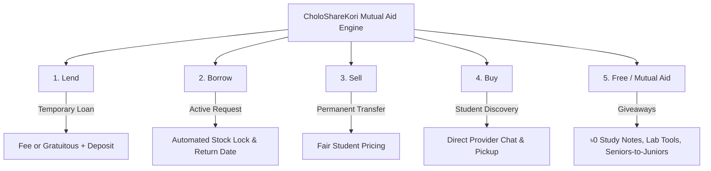
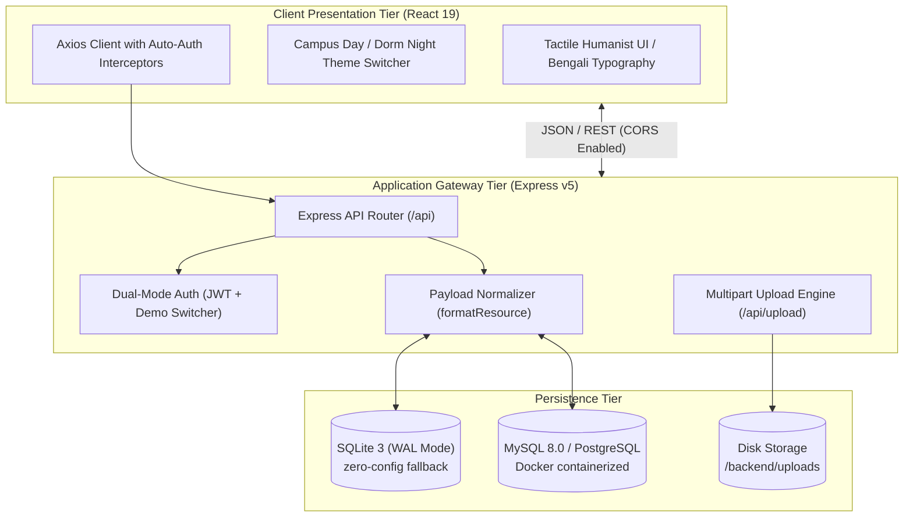
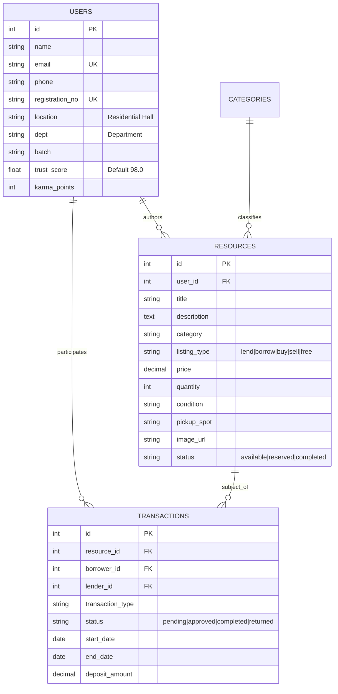

<div align="center">

# 🤝 CholoShareKori (চলো শেয়ার করি)
### *Hyper-Local Campus Mutual Aid & Peer-to-Peer Resource Exchange*

[](https://react.dev/)
[](https://nodejs.org/)
[](https://expressjs.com/)
[](https://www.sqlite.org/)
[](https://www.mysql.com/)
[](https://www.docker.com/)
[-brightgreen?style=for-the-badge)](backend/test_all_scenarios.js)
[](LICENSE)

<br/>

**CholoShareKori** is an open-source, full-stack campus marketplace and mutual-aid engine. Engineered specifically for university ecosystems, it eliminates academic resource barriers, curbs semester waste, and creates a high-trust peer economy across residential halls, departments, and student clubs.

[Features](#-key-features) • [System Architecture](#-system-architecture) • [Sharing Pillars](#-the-5-core-sharing-pillars) • [API Reference](#-api-specification) • [Quick Start](#-quick-start--local-setup) • [Testing](#-testing--quality-assurance)

---

</div>

## 📑 Table of Contents
- [Executive Overview](#-executive-overview)
- [The 5 Core Sharing Pillars](#-the-5-core-sharing-pillars)
- [System Architecture](#-system-architecture)
- [Key Features](#-key-features)
- [API Specification](#-api-specification)
- [Database Schema & Persistence](#-database-schema--persistence)
- [Project Layout](#-project-layout)
- [Quick Start & Local Setup](#-quick-start--local-setup)
- [Testing & Quality Assurance](#-testing--quality-assurance)
- [Preloaded Demo Accounts](#-preloaded-demo-accounts)
- [Roadmap & Contributing](#-roadmap--contributing)
- [License](#-license)

---

## 💡 Executive Overview

University students frequently buy expensive textbooks, lab coats, drafting tools, calculators, and electronics for a single term, only to discard or abandon them after exams. Meanwhile, incoming batches struggle with steep academic setup costs.

**CholoShareKori** solves this through a localized, campus-verified exchange network:
* **Hyper-Localized Pickup**: Items are tagged with campus-specific meeting points (e.g., *TSC, Central Library, Al-Beruni Hall, Fazilatunnesa Hall*).
* **High-Trust Verification**: Campus student profiles incorporate departmental batch data, student ID registration verification, and a peer **Trust Score (0–100%)** with **Karma Points**.
* **Zero-Waste Circular Economy**: Real-time impact telemetry tracks student money saved, items rescued from landfills, and estimated carbon offset.

---

## 🔄 The 5 Core Sharing Pillars

Unlike conventional e-commerce platforms limited to transactions, CholoShareKori structures community exchange into 5 distinct lifecycle workflows:



| Pillar | Economic Model | Use Case | Lifecycle Behavior |
| :--- | :--- | :--- | :--- |
| **Lend** | Temporary Loan (৳0 or Daily Fee) | Scientific calculators, drafting kits, lab coats | Generates loan agreement, tracks return dates, auto-restores stock on return |
| **Borrow** | Active Request / Reserve | Need a book for midterms or a camera for campus fest | Decrements inventory immediately upon request approval |
| **Sell** | Permanent Transfer (Discounted) | Used bicycles, department textbooks, monitors | Provider accepts offer, coordinates hall pickup, marks sold |
| **Buy** | Peer Purchase | Freshmen outfitting dorm rooms on a tight budget | Search by condition, price sort, department badge verification |
| **Free** | ৳0 Mutual Aid | Past-year lecture summaries, leftover dorm essentials | One-click instant claim, prioritize campus peers in need |

---

## 🏗️ System Architecture

The application is structured into decoupled client and server layers with dual database strategy: a **zero-dependency SQLite WAL engine** for instant local development and a **production MySQL/PostgreSQL schema**.



---

## ✨ Key Features

### 1. Dual-Mode Authentication Engine
* **Production Security**: Standard JWT (JSON Web Tokens) with salted `bcrypt` password hashing.
* **Instant Demo Switcher**: Pre-configured tokens (`Bearer demo-jwt-token-98`, `99`, `100`) enable seamless peer-switching between campus users without re-authenticating during tests or demonstrations.

### 2. State-Driven Lending & Inventory Engine
* Automatic inventory locking when a student borrows or orders an item.
* Real-time transaction statuses: `pending` ➔ `approved` ➔ `completed` / `returned`.
* Returning a lent item automatically restores available inventory and updates the peer's activity ledger.

### 3. Integrated Photo Upload Engine
* Handles multipart form submissions (`/api/upload`) with MIME validation (JPEG, PNG, WebP).
* Automatically persists items to local disk storage and serves optimized static assets via Express.

### 4. Human-Crafted Collegiate Aesthetic
* **Typography**: Editorial humanist serif (*Fraunces*) paired with native Bengali typefaces (*Hind Siliguri*).
* **Dual Palettes**: 
  * ☀️ **Campus Day Mode**: Warm baked terracotta, linen ivory, botanical forest green.
  * 🌙 **Dorm Night Mode**: High-contrast, low-fatigue slate with ember accents for late-night study sessions.
* **Responsive Thumb-Zone Layout**: Ergonomic action sheets and navigation pills tailored for one-handed mobile browsing.

### 5. Live Campus Pulse & Impact Telemetry
* Calculates live community metrics: total funds saved by students, units shared, and carbon reduction metrics.
* Real-time activity feed highlighting recent listings and mutual aid events across residential halls.

---

## 🔌 API Specification

All endpoints are hosted at `/api` and return standardized JSON responses:
```json
{
  "success": true,
  "data": {},
  "message": "Operation completed successfully"
}
```

### Authentication (`/api/auth`)
| Method | Endpoint | Description | Auth Required |
| :--- | :--- | :--- | :--- |
| `POST` | `/api/auth/register` | Register new student with university ID & hall | None |
| `POST` | `/api/auth/login` | Authenticate with email/password; returns JWT | None |
| `GET` | `/api/auth/me` | Fetch authenticated student profile | `Bearer JWT` or Demo Token |
| `GET` | `/api/auth/demo-students` | Retrieve pre-seeded campus student profiles | None |

### Resources & Listings (`/api/resources`)
| Method | Endpoint | Description | Auth Required |
| :--- | :--- | :--- | :--- |
| `GET` | `/api/resources` | Query listings (filters: `listing_type`, `category`, `search`, `status`) | None |
| `GET` | `/api/resources/:id` | Fetch listing details with provider info & similar items | None |
| `POST` | `/api/resources` | Create a new listing (with photo URL, condition, spot) | `Bearer JWT` |
| `PUT` | `/api/resources/:id` | Update listing details, pricing, or status | `Bearer JWT` (Owner) |
| `DELETE` | `/api/resources/:id` | Remove a listing | `Bearer JWT` (Owner) |
| `POST` | `/api/resources/:id/star` | Toggle bookmark / saved resource state | `Bearer JWT` |

### Transactions & Lending (`/api/transactions`)
| Method | Endpoint | Description | Auth Required |
| :--- | :--- | :--- | :--- |
| `POST` | `/api/transactions` | Initiate borrow, buy, or free claim request | `Bearer JWT` |
| `GET` | `/api/transactions/incoming` | Provider inbox for pending incoming requests | `Bearer JWT` |
| `GET` | `/api/transactions/outgoing` | Student ledger of active borrow / purchase requests | `Bearer JWT` |
| `GET` | `/api/transactions/history` | Historical audit log of completed transactions | `Bearer JWT` |
| `PUT` | `/api/transactions/:id` | Approve, reject, complete, or return a transaction | `Bearer JWT` |

### Static Assets & Meta (`/api/upload`, `/api/stats`, `/api/locations`)
| Method | Endpoint | Description | Auth Required |
| :--- | :--- | :--- | :--- |
| `POST` | `/api/upload` | Multipart photo upload (returns CDN/local URL) | None |
| `GET` | `/api/stats` | Campus impact analytics (money saved, items shared) | None |
| `GET` | `/api/stats/pulse` | Live stream of campus exchange events | None |
| `GET` | `/api/locations` | Campus residential halls and designated safe spots | None |
| `GET` | `/api/categories` | Resource taxonomy and icons | None |
| `GET` | `/api/health` | Service uptime, RAM consumption & DB diagnostics | None |

---

## 🗄️ Database Schema & Persistence

The relational data model enforces strict referential integrity across student interactions:



---

## 📁 Project Layout

```text
CholoShareKori/
├── backend/
│   ├── index.js                     # Express API entry point & route registration
│   ├── db.js                        # Unified database client (SQLite WAL + MySQL)
│   ├── middleware/
│   │   └── authMiddleware.js        # JWT and demo token verification
│   ├── routes/
│   │   ├── authRoutes.js            # Login, register, demo user switcher
│   │   ├── resourceRoutes.js        # Catalog CRUD, filters, search, recommendations
│   │   ├── transactionRoutes.js     # Lending lifecycle, borrow, return, ledger
│   │   ├── userRoutes.js            # Student profile, karma, trust scores
│   │   ├── statsRoutes.js           # Live campus pulse & impact telemetry
│   │   └── uploadRoutes.js          # Multer photo upload engine
│   ├── src/config/
│   │   ├── init.sql                 # Production MySQL seed & schema
│   │   └── sqlite_init.sql          # Local zero-config SQLite schema
│   ├── test_backend.js              # Unit and integration test suite
│   ├── test_all_scenarios.js        # 52-assertion comprehensive scenario audit
│   └── uploads/                     # Local photo storage
├── frontend/
│   ├── public/
│   │   └── index.html               # Semantic HTML5 entry with Google Fonts
│   ├── src/
│   │   ├── components/              # Tactile components (Navbar, Footer, ResourceCard)
│   │   ├── pages/                   # Core views (Lend, Borrow, Buy, Sell, Free, Profile)
│   │   ├── services/
│   │   │   ├── api.js               # Central Axios client with token interceptor
│   │   │   └── campusData.js        # Fallback datasets and campus halls registry
│   │   ├── index.css                # Obsidian & Terracotta design tokens
│   │   └── App.jsx                  # React Router client navigation
├── docker-compose.yml               # Container orchestration (MySQL, Node, React)
├── README.md                        # Documentation
└── .gitignore                       # Clean repository tracking
```

---

## 🚀 Quick Start & Local Setup

### Prerequisites
* [Node.js](https://nodejs.org/) (v18.x or v20.x LTS)
* [Git](https://git-scm.com/)
* *(Optional)* [Docker Desktop](https://www.docker.com/) for full containerized stack

---

### Option A: Native Local Run (Zero-Config, Recommended)

The platform includes an automatic SQLite fallback with Write-Ahead Logging (WAL). No database server installation required.

#### 1. Clone the repository
```bash
git clone https://github.com/Sadik-khan077/CholoShareKori.git
cd CholoShareKori
```

#### 2. Start the Backend API
```bash
cd backend
npm install
node index.js
```
> The API will launch at `http://localhost:5005`. On first run, it automatically provisions the SQLite database with full sample data.

#### 3. Start the Frontend Client
In a separate terminal:
```bash
cd frontend
npm install
npm start
```
> The web interface will open at `http://localhost:3000`.

---

### Option B: Containerized Run with Docker Compose

To run the complete production topology including MySQL 8.0:

```bash
docker-compose up --build
```
* **Frontend**: `http://localhost:3000`
* **Backend API**: `http://localhost:5005`
* **MySQL Database**: `localhost:3307` (`mydb`)

---

## 🧪 Testing & Quality Assurance

The codebase includes an exhaustive automated test suite covering all authentication types, sharing pillars, image uploads, transaction lifecycles, and error states.

### Run Backend Integration Suite
```bash
cd backend
node test_backend.js
```
```text
--- STARTING BACKEND INTEGRATION TEST SUITE ---
✓ PASS: Health check endpoint returns 200 & healthy
✓ PASS: GET /api/resources returns all 12 authentic campus items
✓ PASS: Filter by listing_type=lend
✓ PASS: GET /api/resources/101 returns Casio Calculator
✓ PASS: Dual-mode auth accepts demo token "demo-jwt-token-98"
✓ PASS: POST /api/transactions creates borrow request
✓ PASS: PUT /api/transactions/:id marks request as approved
...
TEST SUMMARY: 21 PASSED, 0 FAILED
```

### Run Exhaustive 8-Scenario System Audit
```bash
cd backend
node test_all_scenarios.js
```
```text
======================================================================
📊 FINAL TEST AUDIT RESULTS
======================================================================
Total Scenarios Tested:  8
Total Assertions Run:    52
Passed Assertions:       52 (100%)
Failed Assertions:       0
System Status:           ✅ 100% HEALTHY & ALL SCENARIOS PASS
======================================================================
```

### Validate Production Frontend Build
```bash
cd frontend
npm run build
```

---

## 👥 Preloaded Demo Accounts

For rapid testing and grading, 3 verified university student personas are preloaded:

| Student Name | University Email | Password | Role / Details |
| :--- | :--- | :--- | :--- |
| **Nafis Iqbal** | `nafis.iqbal@juniv.edu` | `password123` | Batch 50, CSE • Al-Beruni Hall • Trust: 98.8% |
| **Sumaiya Akter** | `sumaiya.akter@juniv.edu` | `password123` | Batch 51, Pharmacy • Fazilatunnesa Hall • Trust: 99.4% |
| **Tanvir Ahmed** | `tanvir.ahmed@juniv.edu` | `password123` | Batch 49, Economics • Mir Mosharraf Hossain Hall • Trust: 97.2% |

> *Tip: You can also use the 1-click student switcher in the frontend or pass `Authorization: Bearer demo-jwt-token-98` directly in API headers.*

---

## 🗺️ Roadmap & Contributing

- [x] Full 5-pillar resource categorization (Lend, Borrow, Buy, Sell, Free)
- [x] Dual-mode authentication & instant demo account switcher
- [x] Automated inventory locking and restoration on return
- [x] Multipart photo upload engine
- [x] SQLite WAL zero-dependency development fallback
- [ ] Push notifications for due-date return alerts
- [ ] Hall-to-hall real-time campus map visualization
- [ ] Departmental syllabus bundle sharing (1-click semester starter packs)

Pull requests are welcome! Please open an issue first to discuss architectural changes.

---

## 📄 License

This project is licensed under the [MIT License](LICENSE) — see the LICENSE file for details.

<div align="center">
<sub>Crafted with care for university campus communities. <b>চলো শেয়ার করি, অপচয় কমাই।</b></sub>
</div>
